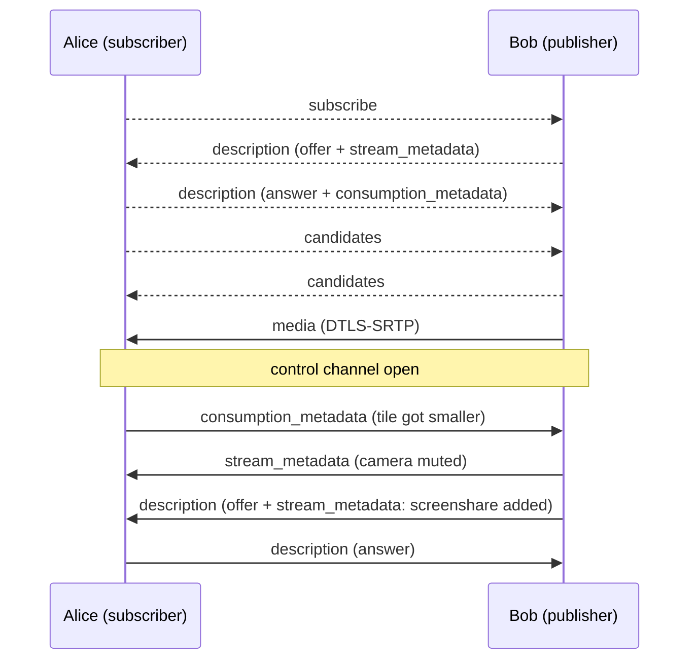

# MSCXXXX: Full mesh transport for MatrixRTC

[MSC4143] introduces MatrixRTC. Concrete transports are defined in separate proposals. [MSC4195] defines an
SFU based transport (livekit). This proposal defines a peer-to-peer transport.

In one sentence:\
Every subscriber opens a direct WebRTC connection to every publisher it wants to receive media from. No server-side infrastructure is
needed apart from the TURN servers homeservers already provide for [VoIP].

The transport only covers establishing WebRTC connections between two MatrixRTC members. Calls, ringing,
invites, call IDs and membership are all handled by [MSC4143] and the respective application.

[MSC4143]: https://github.com/matrix-org/matrix-spec-proposals/pull/4143
[MSC4195]: https://github.com/matrix-org/matrix-spec-proposals/pull/4195
[VoIP]: https://spec.matrix.org/v1.18/client-server-api/#voice-over-ip

## Proposal

### Transport type

A new transport type `m.full_mesh` is introduced. A member publishing on it adds the following data
to `transports.published` in its `m.rtc.member` event:

- `type` (required, string): `m.full_mesh`.
- `device_id` (required, string): The device ID of the publishing client, which subscribers send
  to-device messages to.

Members able to subscribe add `m.full_mesh` to `transports.can_subscribe`.

```json5
{
  type: "m.rtc.member",
  content: {
    slot_id: "m.call#room",
    member: { id: "xyzABCDEF10123", membership: "join" },
    application: { type: "m.call" },
    transports: {
      published: [{ type: "m.full_mesh", device_id: "ABCDEFGHIJ" }],
      can_subscribe: ["m.full_mesh", "m.livekit"],
    },
    sticky_key: "xyzABCDEF10123",
  },
}
```

In encrypted rooms, clients MUST ignore an `m.full_mesh` transport whose `device_id` isn't the device that
sent the `m.rtc.member` event.

A member MUST NOT list more than one `m.full_mesh` object in `transports.published`.

Servers don't need to advertise `m.full_mesh` in `/_matrix/client/v1/rtc/transports`.

### Connection model

Each WebRTC connection is **unidirectional** and belongs to exactly one _(subscriber, publisher)_ pair of
MatrixRTC members:

- The **subscriber** starts the connection by asking the publisher for its media.
- The **publisher** is always the SDP offerer and only sends media and data. The subscriber only receives
  them. The [control channel](#control-channel) is the one exception: it carries control messages in
  both directions.
- If two members subscribe to each other, they use two independent connections.

This lets transports be mixed per direction. Alice can subscribe to Bob over `m.full_mesh` while Bob
subscribes to Alice over `m.livekit`. Because only the publisher creates offers, there is no glare.

At most one connection exists per (subscriber `member.id`, publisher `member.id`) pair.

Connections are set up with [to-device messages](#to-device-messages). After that, all signalling goes
directly between the peers over the connection's [control channel](#control-channel).

### TURN servers

Each client gets ICE servers from its own homeserver via the existing
[`GET /_matrix/client/v3/voip/turnServer`][turnServer] endpoint and passes `uris`, `username` and
`password` to every `RTCPeerConnection` it creates. Clients SHOULD fetch the credentials again before
`ttl` expires and use the new ones for new connections. If the response is empty, the homeserver has no
TURN server. Clients then use host and server-reflexive candidates only. They MUST NOT fall back to a
third-party STUN/TURN server without user consent.

[turnServer]: https://spec.matrix.org/v1.18/client-server-api/#get_matrixclientv3voipturnserver

### Streams

A publisher sends **streams**. Each stream has an ID that is unique within the connection, and a
`purpose`:

| Purpose         | Carried as                                                                     | Stream ID                                                           |
| --------------- | ------------------------------------------------------------------------------ | ------------------------------------------------------------------- |
| `m.usermedia`   | Audio and/or video tracks (SDP `m=audio` / `m=video`)                          | The `MediaStream` ID: the first value of the tracks' `a=msid` lines |
| `m.screenshare` | Video and optionally audio tracks (SDP `m=audio` / `m=video`)                  | The `MediaStream` ID, as above                                      |
| `m.data`        | A WebRTC data channel (in the connection's single SDP `m=application` section) | The data channel's `label`                                          |

Tracks that share a `MediaStream` ID belong to the same stream. New application types MAY introduce additional purposes. Clients MUST ignore streams with a purpose they
don't know, and SHOULD ignore a mismatch between a stream's purpose and the SDP media type carrying it.

The [control channel](#control-channel) is not a stream and never appears in the stream metadata.

#### Stream metadata (publisher → subscriber)

`stream_metadata` describes every stream the publisher currently sends. It is an object keyed by stream ID.
Each value is an object with these properties:

- `purpose` (required, string): The stream's purpose, as above.
- For `m.usermedia` and `m.screenshare`:
  - `audio_muted` (boolean): Whether the stream's audio is muted on purpose. Defaults to `false`.
  - `video_muted` (boolean): Whether the stream's video is muted on purpose. Defaults to `false`.
- For `m.data`:
  - `protocol` (required, string): Names what the stream carries and how its messages are encoded. Uses
    the [Common Namespaced Identifier Grammar]. Applications define their protocols. A subscriber MUST
    ignore data streams with a protocol it doesn't know.

Applications MAY define further properties.

```json5
"stream_metadata": {
  "{3f2a9c1e-7b4d-4e8a-9c2f-1d5e6a7b8c9d}": { "purpose": "m.usermedia", "video_muted": true },
  "{b0c4e2d8-1a3f-4c5e-8d7b-9f0e1a2b3c4d}": { "purpose": "m.screenshare" },
  "mouse_position": { "purpose": "m.data", "protocol": "m.call.mouse_position" }
}
```

[Common Namespaced Identifier Grammar]: https://spec.matrix.org/v1.16/appendices/#common-namespaced-identifier-grammar

#### Consumption metadata (subscriber → publisher)

`consumption_metadata` tells the publisher which streams the subscriber actually uses, and how. The
publisher can then stop sending what nobody looks at and send smaller video to small tiles. It is an
object keyed by stream ID. Each value is an object with these properties:

- `in_use` (boolean): Whether the subscriber uses the stream. Defaults to `true`. While it is `false`,
  the publisher SHOULD stop sending the stream: for media by sending no track (`replaceTrack(null)`) or
  deactivating its encodings, for data by not sending on its channel. This keeps the stream and its
  transceiver, so turning it back on needs no renegotiation.
- `max_width`, `max_height` (integer): The largest video resolution, in pixels, that the subscriber can
  show. The publisher SHOULD scale its video down to fit, for example with `scaleResolutionDownBy` in
  `RTCRtpSender.setParameters()`.
- `max_framerate` (number): The highest video frame rate the subscriber wants.

Streams that aren't listed use the defaults. All of these are hints: the publisher MAY ignore them, so a
subscriber has to cope with receiving a stream at full size.

```json5
"consumption_metadata": {
  "{3f2a9c1e-7b4d-4e8a-9c2f-1d5e6a7b8c9d}": { "max_width": 320, "max_height": 180 },
  "{b0c4e2d8-1a3f-4c5e-8d7b-9f0e1a2b3c4d}": { "in_use": false }
}
```

### To-device messages

All signalling uses [to-device messages] sent to the single device of the target member. Messages MUST be
Olm-encrypted. Recipients MUST discard messages sent in cleartext.

[to-device messages]: https://spec.matrix.org/v1.18/client-server-api/#send-to-device-messaging

Every message contains these common properties:

- `room_id` (required, string): The room containing the slot.
- `slot_id` (required, string): The ID of the slot.
- `member_id` (required, string): The sender's `member.id`.
- `device_id` (required, string): The sender's device ID, which replies are sent to. SDKs and the widget
  API often don't expose the Olm sending device, so the sender states it, like `claimed_device_id` in
  [MSC4143]'s reference implementation.
- `target_member_id` (required, string): The recipient's `member.id`.
- `connection_id` (required, string): A random identifier the subscriber generates for each subscription
  attempt. All messages of the connection use it.
- `seq` (required, integer): Starts at `0` for each (`member_id`, `target_member_id`) pair and goes up by
  `1` with every message between them, across connections. To-device messages can arrive out of order, so
  recipients MUST process them in `seq` order, buffering until gaps are filled. A gap that isn't filled
  within a short timeout (RECOMMENDED: 10 seconds) is skipped.

Recipients MUST discard a message if any of these is true:

- `room_id` and `slot_id` don't match a session that both members are in.
- `target_member_id` is not their own current `member.id`.
- No joined `m.rtc.member` event matches `member_id`.
- That event's sender is not the sender of the to-device message.
- `device_id` is not the device that event belongs to.
- The client knows the Olm sending device of the to-device message, and it differs from `device_id`.
- The message is not `m.rtc.full_mesh.subscribe` and its `connection_id` is not the current connection
  for this member pair. This drops late messages belonging to a replaced or closed connection.

A subscribe request MAY arrive before the subscriber's `m.rtc.member` event. Publishers SHOULD keep such
a request for a short grace period (RECOMMENDED: 10 seconds) before discarding it.

#### `m.rtc.full_mesh.subscribe` (subscriber → publisher)

Asks the publisher to open a connection and send its streams. It contains only the common properties.

#### `m.rtc.full_mesh.description` (both directions)

Carries the initial SDP offer (publisher → subscriber) or answer (subscriber → publisher). Later offers
and answers go over the [control channel](#control-channel).

- `description` (required, object): An [`RTCSessionDescriptionInit`].
  - `type` (required, string): `offer` or `answer`.
  - `sdp` (required, string): The SDP.
- `stream_metadata` (object): REQUIRED on offers. The publisher's [stream metadata](#stream-metadata-publisher--subscriber)
  at the time of the offer.
- `consumption_metadata` (object): Optional on answers. The subscriber's initial
  [consumption metadata](#consumption-metadata-subscriber--publisher).

See [initial metadata](#initial-metadata).

```json5
{
  room_id: "!room:example.org",
  slot_id: "m.call#room",
  member_id: "bobMemberId",
  device_id: "BOBDEVICE",
  target_member_id: "aliceMemberId",
  connection_id: "c0nn3ct10n1d",
  seq: 0,
  description: { type: "offer", sdp: "v=0\r\n..." },
  stream_metadata: {
    "{3f2a9c1e-7b4d-4e8a-9c2f-1d5e6a7b8c9d}": {
      purpose: "m.usermedia",
      video_muted: true,
    },
  },
}
```

#### `m.rtc.full_mesh.candidates` (both directions)

Carries trickled ICE candidates until the control channel is open.

- `candidates` (required, array): An array of [`RTCIceCandidateInit`] objects (`candidate`, `sdpMid`,
  `sdpMLineIndex`, `usernameFragment`). A `candidate` set to the empty string signals end-of-candidates.

Clients SHOULD collect candidates for a short time (for example 200ms) and send them in one message.
Candidates are gathered after the local description is set, so `seq` orders them after their
description. Recipients MUST still wait for `setRemoteDescription` to complete before adding them.

#### `m.rtc.full_mesh.close` (both directions)

Closes the connection. The recipient closes the corresponding `RTCPeerConnection`.

- `reason` (string): An optional human-readable reason.

`close` is always a to-device message, even when the control channel is open, because closing the peer
connection would race a channel message.

[`RTCSessionDescriptionInit`]: https://www.w3.org/TR/webrtc/#dom-rtcsessiondescriptioninit
[`RTCIceCandidateInit`]: https://www.w3.org/TR/webrtc/#dom-rtcicecandidateinit

### Control channel

Every connection has exactly one **control channel**: a WebRTC data channel for signalling once the
connection is up. It is set up as follows:

- `label`: `m.rtc.full_mesh.control`.
- `negotiated`: `true`, with `id`: `0`. Both sides create it themselves, so it opens with the connection,
  without the round trip of an `ondatachannel` announcement.
- Ordered and reliable (the defaults).

The publisher creates the channel before its first offer, so that the offer contains the connection's
`m=application` section. The subscriber creates its side right after applying that offer.

The label and ID `0` are reserved. Data streams (`m.data`) are separate channels with other labels and
browser-assigned IDs (`negotiated: false`). A channel with the reserved label that arrives through
`ondatachannel` is ignored.

#### Messages

Each message is one UTF-8 JSON object, sent as a text message, with a `type` property:

| `type`                 | Direction              | Content                                                                                                                                                                                          |
| ---------------------- | ---------------------- | ------------------------------------------------------------------------------------------------------------------------------------------------------------------------------------------------ |
| `stream_metadata`      | publisher → subscriber | `stream_metadata`: the complete current [stream metadata](#stream-metadata-publisher--subscriber). It replaces the previous one.                                                                 |
| `consumption_metadata` | subscriber → publisher | `consumption_metadata`: the complete current [consumption metadata](#consumption-metadata-subscriber--publisher). It replaces the previous one.                                                  |
| `description`          | both                   | `description`: an [`RTCSessionDescriptionInit`]. Offers come from the publisher and also contain the `stream_metadata` that applies once the offer is applied. Answers come from the subscriber. |
| `candidates`           | both                   | `candidates`: as in [`m.rtc.full_mesh.candidates`](#mrtcfull_meshcandidates-both-directions).                                                                                                    |

Receivers MUST ignore messages with an unknown `type`, so that future versions can add types.

The channel is ordered, reliable and belongs to one connection, so messages need no `seq` or
`connection_id`.

Once the control channel is open, both sides MUST send every message of the connection over it, apart
from `close`. A single ordered path keeps updates from racing each other. If the channel closes, the
connection has [failed](#failure).

#### Changing streams

The publisher announces every change over the control channel:

- **Muting, unmuting or other metadata changes:** a `stream_metadata` message. No renegotiation.
- **Adding or removing a media stream:** a `description` offer carrying the new `stream_metadata`, which
  the subscriber answers. The metadata applies with the offer, so no track arrives without it.
- **Adding a data stream:** `stream_metadata` including the stream, then the channel with that label. No
  renegotiation is needed. The subscriber matches the channel from `ondatachannel` by its label.
- **Removing a data stream:** `stream_metadata` without the stream, then the channel is closed.

The publisher MUST NOT send a new offer while a previous one is still unanswered (signalling state not
`stable`). Instead it waits for the answer and combines all changes made in the meantime into one offer.

#### Initial metadata

The to-device offer and answer carry the initial `stream_metadata` and `consumption_metadata`. Neither
side has to wait for the control channel before it knows what a track is or what to send, and the channel
only carries updates. It opens after the offer and answer are applied, so updates can't overtake the
initial state.

### Procedures

#### Subscribing

A subscriber (Alice) that wants media from a joined member (Bob) whose `transports.published` contains an
`m.full_mesh` object:

1. Alice creates a new `connection_id` (random) and sends `m.rtc.full_mesh.subscribe` to Bob's `device_id`.
2. Bob validates the request as described above. If Bob doesn't publish `m.full_mesh`, or the request is
   invalid, Bob MAY reply with `m.rtc.full_mesh.close`. If Bob already has a connection for Alice's
   `member.id`, he closes it and replaces it with the new one.
3. Bob creates an `RTCPeerConnection` using his own ICE servers, creates the control channel, and adds
   his current tracks as `sendonly`. He then creates an offer, sets it as the local description and sends
   it with `stream_metadata` in an `m.rtc.full_mesh.description` message.
4. Alice creates an `RTCPeerConnection` using her own ICE servers and sets the offer as the remote
   description. She creates her side of the control channel. She then creates an answer (`recvonly`),
   sets it as the local description and sends it in an `m.rtc.full_mesh.description` message, optionally
   with her initial `consumption_metadata`.
5. Both sides send `m.rtc.full_mesh.candidates` as they gather candidates.
6. Once the connection is up, the control channel opens. All further signalling uses it.



Dashed arrows are to-device messages. Solid arrows go directly between the peers.

#### Closing

- The subscriber sends `m.rtc.full_mesh.close` when it no longer wants the media, or when the publisher
  leaves the slot or stops publishing `m.full_mesh`.
- The publisher sends `m.rtc.full_mesh.close` when it stops publishing `m.full_mesh`, or when the
  subscriber is no longer considered joined as per [MSC4143]. Publishers MUST stop sending media to
  members that are no longer joined.
- Leaving the slot closes all of a member's connections.

#### Failure

If a connection's ICE state becomes `failed`, or its control channel closes, the subscriber MAY send
`m.rtc.full_mesh.close` and then subscribe again with a new `connection_id`. It SHOULD use exponential
backoff between attempts. Publishers don't retry.

### End-to-end encryption

WebRTC always encrypts media with DTLS-SRTP, and data channels with DTLS. Each side's DTLS certificate
fingerprint is part of its SDP. The SDP is carried in Olm-encrypted to-device messages, and recipients
check that the sending device matches the member's `m.rtc.member` event. As a result, the fingerprints are
authenticated end to end between the two member devices, and everything on the connection is end-to-end
encrypted. Renegotiation offers arrive over the control channel and are authenticated by that DTLS
session. TURN servers relay ciphertext only. DTLS uses an ephemeral key exchange, so every connection
also has forward secrecy.

`m.full_mesh` therefore doesn't use the `m.per_member` key material from [MSC4143], and its required key
length is 0 bytes. A client whose published transports are all `m.full_mesh` doesn't need to send
`m.rtc.encryption_key` messages. Media received over a connection that was set up as described above
counts as encrypted for the purposes of [MSC4143].

## Potential issues

### Scalability

Every publisher uploads one copy of its media per subscriber, and the number of connections grows
quadratically with the number of members. The transport is only suitable for small sessions. Clients MAY
refuse subscriptions beyond a limit they choose. Consumption metadata reduces the bandwidth, not the
quadratic growth.

### To-device latency

Connection setup needs about two to-device round trips, possibly over federation. This is slower than
connecting to an SFU. After setup, nothing goes through the homeserver any more.

### Twice the connections for bidirectional media

Using one connection per direction doubles the number of ICE and DTLS handshakes between two members who
both publish and subscribe. In return, transports can be mixed and there is no glare.

## Alternatives

### One bidirectional connection per pair

[MSC3401] used one connection per pair of members, with a tie-break rule for who calls whom. This halves
the number of connections. However, it ties both directions to the same transport and needs glare
handling for renegotiation.

[MSC3401]: https://github.com/matrix-org/matrix-spec-proposals/pull/3401

### Subscriber as offerer

The subscriber could send an offer with `recvonly` transceivers directly, saving one message. However, the
subscriber doesn't know how many streams the publisher has, so the publisher would need to make offers
for renegotiation anyway. Making the publisher the only offerer keeps a single code path.

### Reusing `m.call.*` events

The legacy `m.call.invite`, `m.call.answer` and similar events bring call IDs, party IDs, invite lifetimes
and ringing semantics. MatrixRTC already handles all of these, so the events were not reused.

### Using `m.per_member` keys with SFrame

Media could also be encrypted with the [MSC4143] key material on top of DTLS-SRTP. This adds no security
over authenticated DTLS-SRTP, so it is not required.

### Updates over to-device messages

Updates such as mute changes could be to-device messages. Every one would then go through the
homeserver, possibly over federation, once per subscriber, and lag behind the media.

### Inferring mute from the media

A receiver could treat a track without packets as muted. That can't tell a camera turned off from a bad
network, and a muted track may still send silence or black frames.

### Mixing data into the control channel

Application data could be another message type on the control channel. Separate `m.data` channels keep
it from delaying signalling, can each choose their reliability, and can be turned off like media.

## Security considerations

### IP address exposure

Peers learn each other's IP addresses from ICE candidates. Clients MAY set `iceTransportPolicy: "relay"`
so that only their homeserver's TURN server is exposed, at the cost of more latency. Candidates are only
sent through Olm-encrypted to-device messages or the DTLS-protected control channel, and only to members
that are joined to the slot.

### Unencrypted rooms

In unencrypted rooms, `m.rtc.member` events are not authenticated. A malicious homeserver could forge a
member event with a `device_id` it controls and receive media. Signalling itself stays Olm-encrypted, so
existing connections can't be tampered with. Clients SHOULD only send to devices that are cross-signed
by their owner, as described in [MSC4153].

[MSC4153]: https://github.com/matrix-org/matrix-spec-proposals/pull/4153

### Claimed device IDs

A recipient that can't check `device_id` against the Olm sending device only knows that the message
comes from the right user. Another device of that same user could pretend to be the device of the
member and receive its media. Only that user's own devices can do this, the same as for `claimed_device_id`
in [MSC4143]'s reference implementation. Clients SHOULD check the Olm sending device wherever their SDK
exposes it.

### Removed members

Publishers stop sending media when a subscriber is no longer joined. This way, redacting member events
or removing someone from the room also cuts their media.

### Untrusted metadata

The control channel only connects the two members of the connection, but each side can still send
anything over it. Receivers MUST validate metadata before acting on it, for example by bounding
`max_width` and `max_height`. They MUST NOT treat a `protocol` or `purpose` as permission to do more than
the application would allow anyway.

## Unstable prefix

| Stable identifier             | Purpose               | Unstable identifier                            |
| ----------------------------- | --------------------- | ---------------------------------------------- |
| `m.full_mesh`                 | Transport type        | `org.matrix.mscXXXX.full_mesh`                 |
| `m.rtc.full_mesh.subscribe`   | To-device event type  | `org.matrix.mscXXXX.rtc.full_mesh.subscribe`   |
| `m.rtc.full_mesh.description` | To-device event type  | `org.matrix.mscXXXX.rtc.full_mesh.description` |
| `m.rtc.full_mesh.candidates`  | To-device event type  | `org.matrix.mscXXXX.rtc.full_mesh.candidates`  |
| `m.rtc.full_mesh.close`       | To-device event type  | `org.matrix.mscXXXX.rtc.full_mesh.close`       |
| `m.rtc.full_mesh.control`     | Control channel label | `org.matrix.mscXXXX.rtc.full_mesh.control`     |
| `m.data`                      | Stream purpose        | `org.matrix.mscXXXX.data`                      |

## Dependencies

This proposal depends on [MSC4143].
